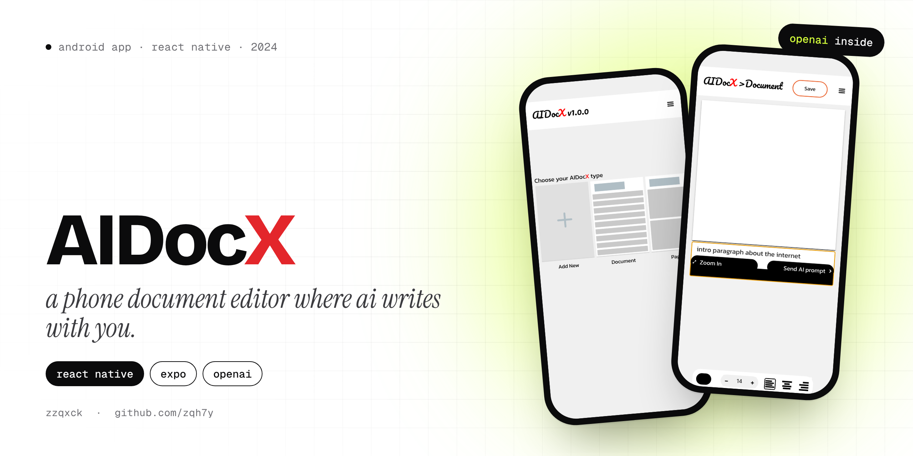
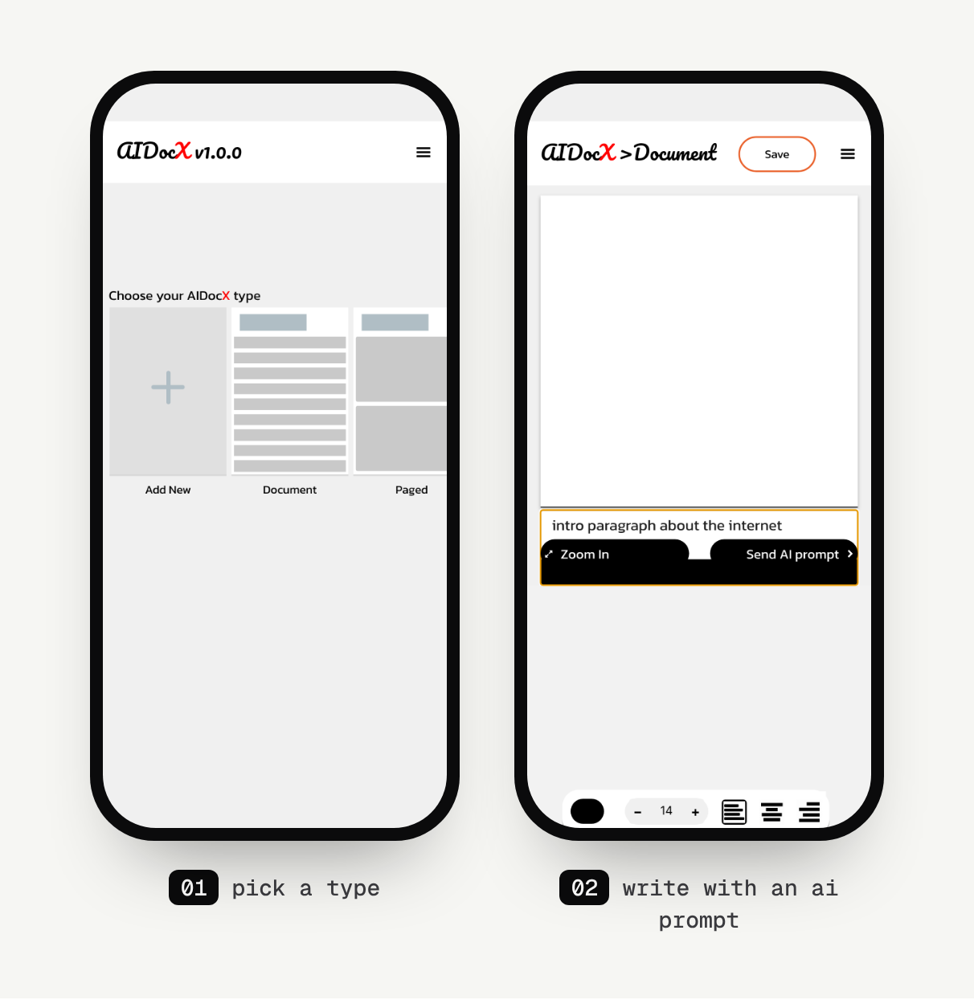

<p align="center">
  
</p>

<p align="center">
  
  
  
</p>

# AIDocX

AIDocX is a document editor for your phone with AI built into the page. You open a document, type what you want in the prompt box ("an intro paragraph about the internet") and the answer lands in the document, where you can edit it, style it and save it.

It's a 2024 project built around one idea: Word on your phone, but the AI writes the first draft.

## Screens

<p align="center">
  
</p>

## Features

- **Document types.** Start from a type card: a regular **Document**, with **Paged** and **Add New** shown next to it for what's coming.
- **AI prompt under the page.** Write a prompt and press **Send AI prompt**. The reply is placed in the document, and you can keep editing it by hand.
- **Text styling.** A toolbar for font size (− / +), a colour picker grid and left, centre or right alignment.
- **Save.** Documents are saved on the phone with AsyncStorage.
- A custom header with the AIDocX logo (the red X) and the document name.

## How it's built

| Part | Tech |
|---|---|
| Framework | React Native 0.74, Expo SDK 51 |
| Navigation | React Navigation (stack) |
| AI | `openai` package, through a small `queryOpenAI` helper in `util/openai` |
| Config | `app.config.js` reads `OPENAI_API_KEY` from a `.env` file with `dotenv` |
| Storage | `@react-native-async-storage/async-storage` |
| Styling | One style file per component in `style/` |

The code is split into `screen/` (Home, Document), `component/` (Header, File, Edit, Paragraph) and `style/`.

## Run it yourself

```bash
git clone https://github.com/zqh7y/AIDocx.git
cd AIDocx
npm install
echo "OPENAI_API_KEY=your-key-here" > .env
npx expo start
```

Two files aren't in the repo and need to be added before it runs: `util/openai.js` (the helper that calls the API with your key) and the two fonts in `font/` (`Pac.ttf` and `Kan.ttf`). The API key stays in your local `.env` and is never committed.

---

<p align="center">
  Made by <b>zzqxck</b> · <a href="https://zqh7y.github.io/Portfolio/">portfolio</a> · <a href="https://github.com/zqh7y">more projects</a>
</p>
